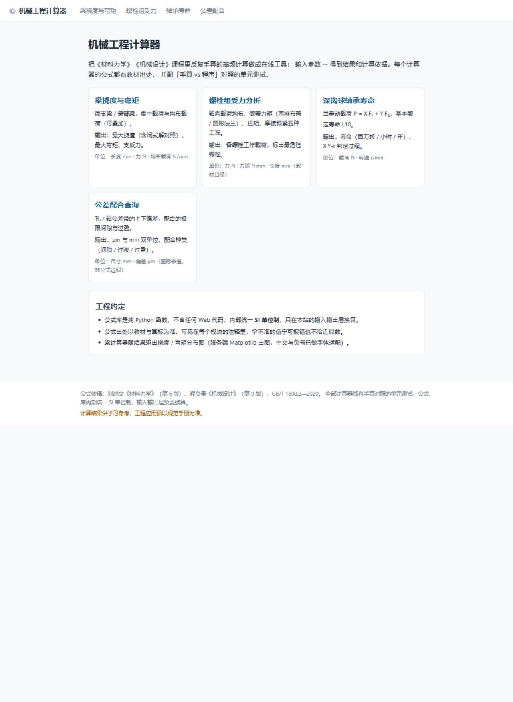
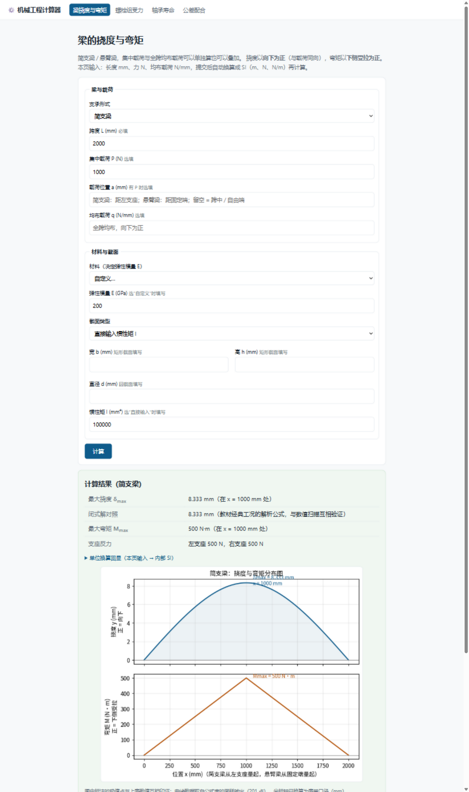
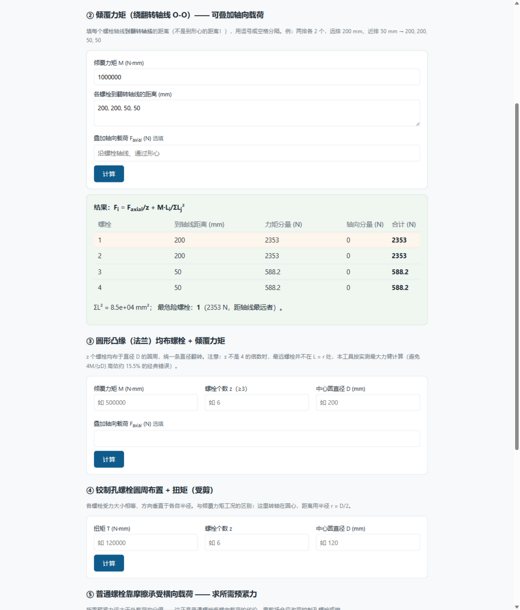
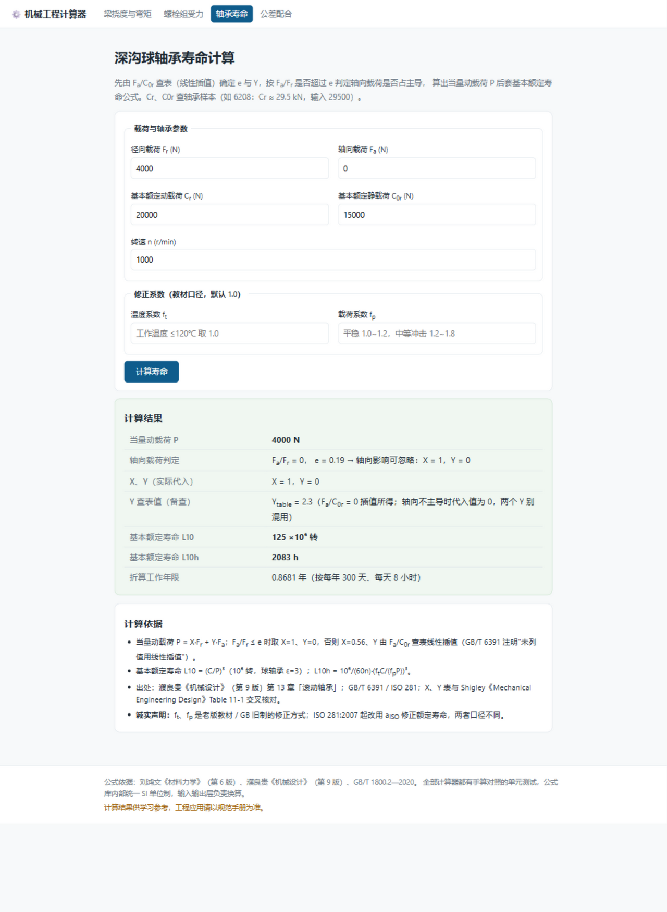
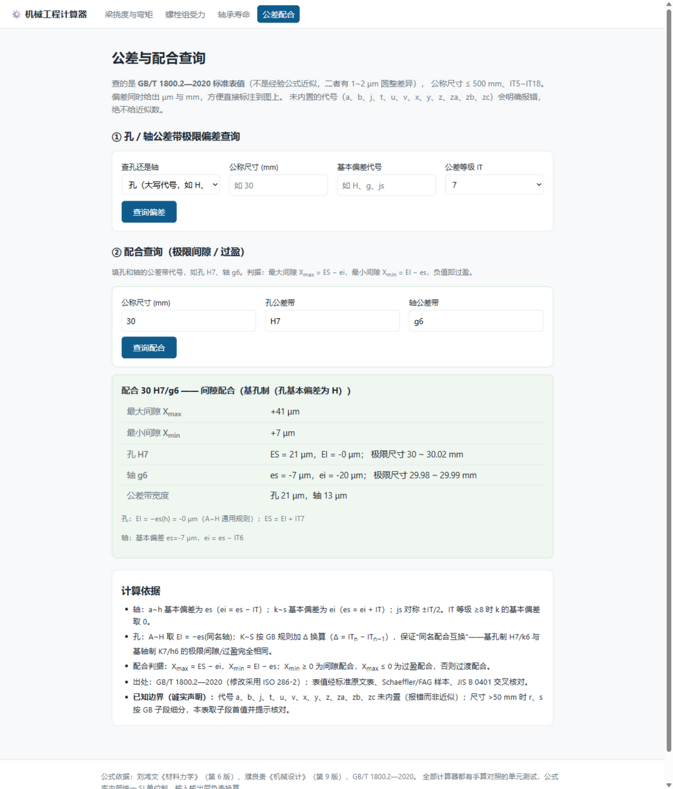

# 机械工程计算器 Web 版

把材料力学、机械设计课程里的高频计算做成在线工具。纯 Python 公式库 + Flask Web 层 + Matplotlib 出图，每个计算器都有手算对照的单元测试。

> 我的第二个作品集项目 · 任务书见 [zzz1280/zzz1280.github.io/projects](https://github.com/zzz1280/zzz1280.github.io/blob/main/projects/02-mech-engineering-calculator.md)

## 界面预览

| 首页 | 梁挠度与弯矩（含分布图） |
| --- | --- |
|  |  |

| 螺栓组受力分析 | 轴承寿命 / 公差配合 |
| --- | --- |
|  |   |

以上均为真实运行截图，示例数值与手算对照一致（如简支梁跨中集中力 δ=8.333 mm、φ30 H7/g6 最大间隙 +41 μm）。

## 当前进度

**✅ 项目已完成（2026-10-24）。** 五个阶段全部走完：

- [x] **阶段 1｜公式库**（2026-09-07）：`calcs/` 纯函数模块 + **49 项手算对照测试全部通过**
  - `beam.py` 梁的挠度与弯矩（简支 / 悬臂，集中 / 均布载荷）
  - `bolt_group.py` 螺栓组受力（轴向 / 倾覆 / 扭矩 / 摩擦预紧）
  - `bearing.py` 深沟球轴承寿命（L10 基本额定寿命）
  - `fits.py` 常用配合公差查询（基孔制 / 基轴制）
- [x] **阶段 2｜Flask Web 化**（2026-10-24）：4 个计算器路由 + 表单校验 + 结果页，
      Web 层新增 **35 项测试**；`calcs/` 公式库零改动直接复用
  - `app.py`：路由 + 输入层单位换算（换算前后在结果页回显）+ 有效数字显示（4 位）
  - `web_inputs.py`：脏输入拦截（空值 / 非数字 / 越界 → 中文提示，带字段名）
  - `templates/ + static/`：服务端渲染，无前端框架、无数据库、无 JS 依赖
  - 错误输入友好提示；公式库的"诚实报错"（如公差代号未内置）原样透传展示
- [x] **阶段 3｜挠度曲线图**（2026-10-24）：服务端 Matplotlib 出图，新增 6 项图表层测试
  - `plots.py`：挠度 / 弯矩双联分布图，极值点标注与结果表格互相印证；PNG 以 data URI 内嵌，无临时文件
  - 中文与负号：`axes.unicode_minus=False` + 字体候选链；以"缺字形警告零输出"验证（悬臂梁负弯矩是负号渲染的天然考验）
- [x] **阶段 4｜部署准备**（2026-10-24）：仓库具备 Render 一键部署条件，**最终决定不上线，配置留作备用**
  - `render.yaml`（Blueprint）：`gunicorn --bind 0.0.0.0:$PORT "app:create_app()"`，free 层，健康检查 `/`
  - 捆绑 `fonts/NotoSansSC-Regular.otf`（OFL 开源许可）：云端环境无 CJK 字体时的兜底，
    并有"候选链只剩捆绑字体"的测试**模拟线上环境**（中文 + 悬臂梁负弯矩零缺字形警告通过）
  - 生产级 WSGI 冒烟：gunicorn 为 Unix 服务器，本地用 waitress 以**相同的应用工厂模式**验证通过
  - 未上线原因：目标是国内同学真实使用，海外免费托管访问慢且会休眠，反而影响体验（详见任务书进度日志）
- [x] **阶段 5｜收尾**（2026-10-24）：真实运行截图上站（见「界面预览」）、README 完善、主页卡片更新

## 本地运行

```bash
pip install -r requirements.txt   # pytest + Flask + matplotlib + gunicorn
python -m pytest tests/ -v        # 运行 91 项单元测试（公式库 49 + Web 层 35 + 图表层 7）
python app.py                     # 启动站点，浏览器访问 http://127.0.0.1:5000
```

### 部署（备用方案，未启用）

仓库保留 `render.yaml`，随时可上线：Render 控制台 → New → Blueprint → 选中本仓库 → Apply，
首次构建约 3~5 分钟。免费层闲置 15 分钟会休眠，首次唤醒需 30~60 秒。

## 公式来源

| 计算器 | 出处 |
| --- | --- |
| 梁挠度与弯矩 | 刘鸿文《材料力学》（第 6 版）第 6 章「弯曲变形」及附录Ⅱ；孙训方《材料力学》附录Ⅱ |
| 螺栓组受力 | 濮良贵《机械设计》（第 9 版）第 5 章「螺纹连接」；邱宣怀《机械设计》（第 4 版）同章 |
| 轴承寿命 | 濮良贵《机械设计》（第 9 版）第 13 章「滚动轴承」；GB/T 6391 / ISO 281；X、Y 系数表与 Shigley《Mechanical Engineering Design》Table 11-1 及 JIS B 1518 交叉核对 |
| 公差配合 | GB/T 1800.2—2020（修改采用 ISO 286-2）标准表值（非经验公式）；表值经标准原文表、Schaeffler/FAG 样本、JIS B 0401 交叉核对 |

补充说明：轴承模块的 f_t / f_p 修正系数为老版教材 / GB 旧制口径，与 ISO 281:2007 起的
a_ISO 修正额定寿命不同；材料弹性模量为教材典型值，非材料标准保证值。

## 免责声明

**本工具计算结果仅供学习参考，工程应用请以规范手册为准。**
所有公式均标注出处并配有手算对照测试，但任何计算工具都不能替代设计规范、
标准图册与有资质工程师的校核。图内中文字体为 Google Noto Sans SC（SIL OFL 1.1 许可）。

## 工程约定

- 公式模块是**纯函数**（输入参数 → 输出结果），不含任何 Web 代码；内部统一 SI 单位制，只在接口层做单位换算
- 所有尺寸 / 系数取自《机械设计》《材料力学》教材与设计手册，出处写在代码注释里
- 每个计算器都有**手算对照用例**——对照不通过不许合并

### Web 层输入单位（阶段 2）

| 计算器 | 输入单位 | 说明 |
| --- | --- | --- |
| 梁 | 长度 mm、力 N、均布载荷 N/mm、模量 GPa、惯性矩 mm⁴ | 唯一需要真正换算的页面，换算链在结果页回显 |
| 螺栓组 | 力 N、力矩 N·mm、长度 mm | 教材口径，与公式库一致，无需换算 |
| 轴承 | 载荷 N、转速 r/min | 与公式库一致，无需换算 |
| 公差 | 尺寸 mm、偏差 μm | 公差行业惯例，与公式库一致，无需换算 |

## 诚实记录（阶段 1 踩坑）

1. 圆形法兰闭式解 `4M/(zD)` 在 z 不是 4 的倍数时会**高估约 15.5%**（z=6 时最远螺栓只在 0.866r 处）。已改为代入实测最大力臂，并加断言防止改回去。
2. 轴承当量动载荷的 `Y`：查表值（`Y_table`）与实际代入值（轴向不主导时取 0）是两回事，已拆成两个字段避免混用。

## 诚实记录（阶段 2 决策）

1. 梁的载荷位置 a 超出跨度时，报错在 **Web 层用 mm 预检**——公式库的同类报错按 SI（m）写的，直接透传用户看不懂。
2. 纯轴向载荷时库返回 F_a/F_r = inf，页面上转成 `∞` 展示（包装新 dict，不改库返回值）。
3. 库的内部自检断言（AssertionError）**不**转成友好提示——那是代码 bug，不该伪装成输入错误。

## 已知缺口

- 公差代号 a、b、j、t、u、v、x、y、z、za、zb、zc 未内置，遇到会报错（而非给近似值）；r/s 在 >80 mm 段无可靠数据源
- 梁模块仅支持向下载荷；未做"超出适用范围"提示（长径比 / 大变形），属任务书加分项
- 轴承 f_t / f_p 采用教材口径（老制），与 ISO 281:2007 的 a_ISO 系数不同，正式 README 需声明
